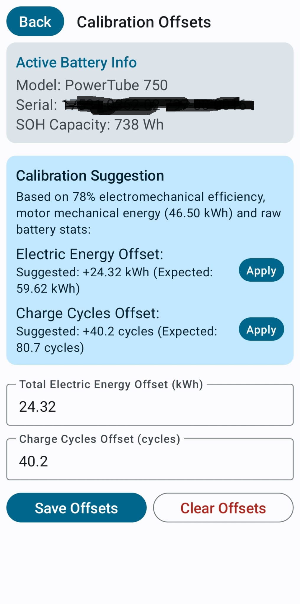

# Battery Calibration Offsets

The eBikeMonitor app allows you to configure per-battery offsets for **Total Electric Energy (kWh)** and **Charge Cycles** to resolve discrepancies caused by historical BMS tracking limitations or firmware update boundaries.

> [!IMPORTANT]
> **When is calibration needed?**
> Calibration offsets are **only** required if the battery was run on a very old BMS firmware (which had cycle/energy tracking bugs) for a long period of time. For batteries that have always run modern firmware, the BMS registers these values accurately, and calibration is not needed.

## The Paradox

If an eBike battery was run on older BMS firmware for a long period, it may have failed to correctly record all charge cycles (`0x8096`) and electrical throughput (`0x80B0`). Over time, this leads to a physically impossible mismatch where the motor's native mechanical work counter (`0x809C`) exceeds the battery's reported electrical throughput:
*   Example: 46.50 kWh mechanical vs. 35.00 kWh electrical (apparent efficiency of >100%).
*   Example: 6,000 km odometer vs. 40.2 charge cycles (an impossible ~150 km per cycle average in Sport/Turbo support).

## How Calibration Offsets Work

Since the motor (Drive Unit) correctly tracks lifetime mechanical energy and odometer distance, we can use these values to calibrate the battery's electrical telemetry.

Offsets are stored on a **per-battery** basis, identified by the battery's unique hardware serial number (`0x0081`). When the app connects to the eBike, the corresponding offsets are loaded and applied automatically:
1.  They are displayed in the App UI.
2.  They are applied before publishing metrics to Home Assistant via MQTT.
3.  This keeps the dashboard and smart home integration physically consistent.

## Using the Suggestion Engine

To make calibration simple, the Calibration screen includes a suggestion engine:

1.  Connect your smartphone to the eBike.
2.  Navigate to **Settings** -> **Calibration Offsets**.
3.  The engine will read your active battery's serial number, usable capacity (e.g. 739 Wh), and the motor's cumulative mechanical energy.
4.  It estimates the expected electrical throughput and charge cycles based on a standard **78% electromechanical efficiency**.
5.  Tap **Apply** next to the suggested values to copy them, then tap **Save Offsets** to save them.

## Clearing Offsets

If you wish to remove the calibration offsets and view the raw telemetry reported directly by the BMS, tap **Clear Offsets** inside the calibration screen.
